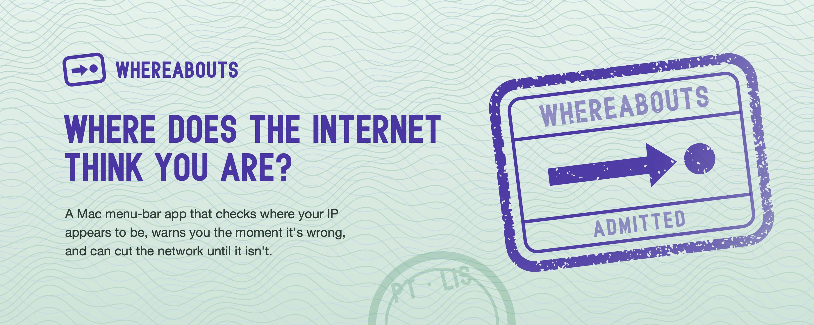
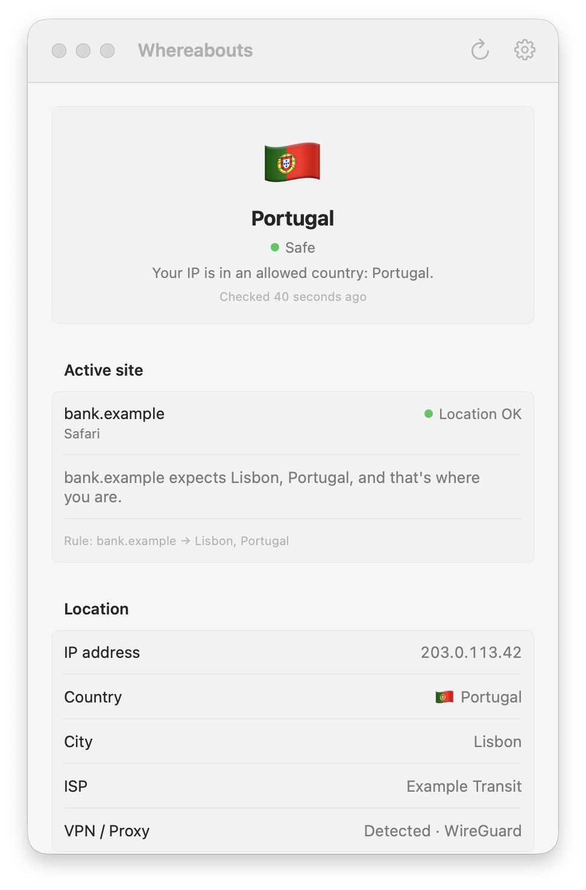
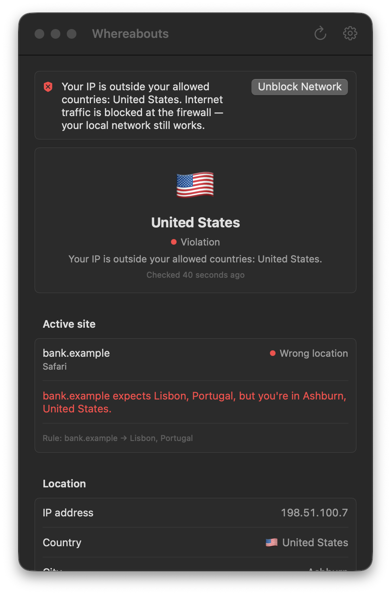
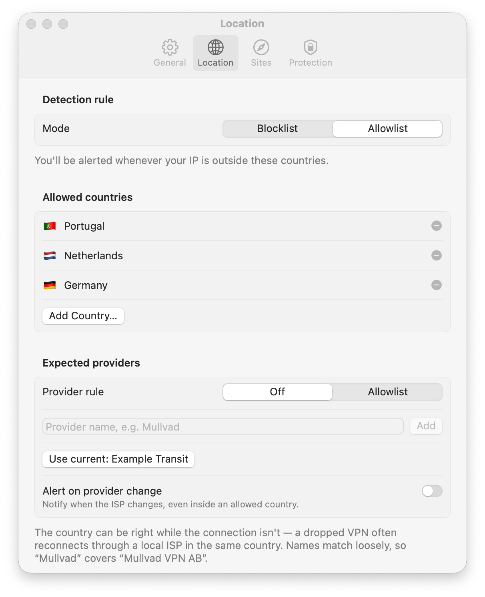

# Whereabouts



A macOS menu-bar app that keeps checking where the internet thinks your Mac is, and warns you or cuts the network when that place is wrong.

Whereabouts doesn't ask whether your VPN is connected. It asks where you appear to be and acts on that answer. On an interval it looks up the location of your public IP, checks it against your rules, and shows the answer in the menu bar as a place: a country code, a flag or a city.

> [!TIP]
> **Pairs with [Alibi](https://github.com/doxigo/alibi), its companion browser extension.** Whereabouts covers the Mac: where your IP appears to be, and whether the Mac's time zone, region, DNS, IPv6 and UDP tell the same story. Alibi covers the browser: a Chrome extension that sets the time zone, geolocation and locale sites see to match your VPN, for every site or one at a time. Run both and the Mac and the browser agree with your connection. See what sites see on Alibi's [check page](https://doxigo.github.io/alibi/).

## Screenshots

<picture>
  <source media="(prefers-color-scheme: dark)" srcset="Branding/screenshots/menubar-dark.png">
  
</picture>

| All clear | Kill switch engaged, dark mode | Country rules |
|---|---|---|
|  |  |  |

The screenshots use made-up data from the app's demo mode (`--demo`). `Branding/screenshots.sh` regenerates them.

## What it does

- **Country rules.** Allow or block countries.
- **Per-site rules.** Give a site its own location rule. Whereabouts watches the active browser tab through Apple Events and checks that site's rule against where you appear to be. Firefox-family browsers don't support this, so they get a best-effort read through Accessibility instead.
- **ISP checks.** Keep an allowlist of expected ISPs, and get an alert when the ISP changes.
- **Leak checks.** It also checks the quieter ways a location leaks: the IPv6 exit, the address UDP leaves from, and the DNS resolvers. UDP is what WebRTC uses, so its address is one any page can read. When it's another address in the same place, as happens when a proxy sends some connections out a second address, Whereabouts flags it without calling it a leak: the place is right, but a site sees two addresses for one visitor. A leak sends a notification, but it never engages the kill switch.
- **Alerts.** Choose how a wrong location reaches you: a colored menu-bar item, a notification, a sound, a red line along the top of every screen. Turning the VPN off on purpose? **Pause for 1 Hour** in the menu holds the alerts and the kill switch.
- **Kill switch.** Cuts internet traffic on a country or ISP violation, or on a per-site rule that asks for it. If you unblock by hand, you get two minutes to reconnect your VPN: if the location still isn't allowed then, it blocks again. It re-arms sooner once every check is clear. With **Confirm before blocking** on, a second lookup provider cross-checks each violation. If the two disagree, the kill switch waits for the next check to agree.
- **Hold the network during sleep.** Apps reconnect the moment the Mac wakes, often before the VPN does, and that first connection goes out over your own ISP. With this on (Settings › Protection, off by default, needs the kill switch), Whereabouts blocks traffic as the Mac goes to sleep and lifts the block once the first check after waking finds your location allowed. While it holds, only your VPN and Whereabouts' own lookups get through. See [the details](#holding-the-network-during-sleep).
- **Computer name.** The router and every device on the network you join can see your Mac's name, VPN or not, and macOS names it after you by default (Alice's MacBook Pro). Whereabouts warns while the name includes yours, and Settings › Protection renames the Mac (and its `.local` name) after asking for your admin password once.
- **Time zone, region and home clock.** Optionally moves the Mac to the IP exit's time zone and region, including when VPN detection is unavailable. A positively identified non-VPN connection restores the home settings; an unknown VPN flag does not. With **Follow Alibi's location** on too (off by default, and not recommended), a place in Alibi for all sites (Tokyo, say) moves the Mac to that place's time zone and region instead, so the Mac no longer matches your IP address; Off and Match my IP address in Alibi leave it to the connection. The menu-bar clock keeps showing your home time either way. No app can remove the macOS clock, so a setting shrinks it to its small analog face instead.
- **Apps on home time.** Some apps should keep your own hours wherever the Mac is, like a chat app or a calendar. Add them in Settings › Time Zone and Whereabouts opens them with your home time zone in `TZ`, as `open --env TZ=<zone>` would. One that starts on another zone (from the Dock, a login item or its own updater) is quit and opened again on home time. Apple's own apps hide their environment, so one of those that's already running when Whereabouts starts is caught the next time it opens.
- **History.** Past lookups are kept, so you can see where this Mac has been seen.
- **Alibi follows along.** With [Alibi](https://github.com/doxigo/alibi) on **Match my IP address**, Whereabouts tells it the moment the exit changes, so the browser's time zone, language and location move with your VPN without waiting for Alibi's own once-a-minute check.
- **git-ip-guard follows along.** [git-ip-guard](https://github.com/doxigo/git-ip-guard) stops git from reaching your remotes while your IP is in a sanctioned country. While Whereabouts runs, git-ip-guard reads the location from Whereabouts' status file instead of looking it up again, so git and the menu bar agree on where you are. Settings › Protection shows whether it's installed, links to it if not, and has a switch to stop sharing.

### How Alibi hears about a new exit

Each time Whereabouts starts, it registers itself with Chrome and Brave as a native messaging host named `com.doxigo.whereabouts`. It writes `com.doxigo.whereabouts.json` into `~/Library/Application Support/Google/Chrome/NativeMessagingHosts` and `~/Library/Application Support/BraveSoftware/Brave-Browser/NativeMessagingHosts`, for whichever of the two is installed. The manifest points at the app's own binary and admits only Alibi's pinned extension ID, `dhlpjjenplighmpbogjpmljbahbnjpfa`. Moving the app is fine: the next launch rewrites the path.

When a check finds a new exit, the app writes its time zone, the country's most likely locale and its coordinates to `alibi.json` in `~/Library/Application Support/Whereabouts`. While Alibi has a cover on Match my IP address, or a place for all sites, Chrome keeps a copy of Whereabouts running in host mode (`Whereabouts chrome-extension://<id>/`). That copy sends Alibi the current exit, then each new one as soon as the file changes. It exits when Chrome hangs up or the app quits, and Alibi goes back to its own lookup.

The host also tells Alibi whether it takes Alibi's cover: while **Match my Mac's time zone and region** and **Follow Alibi's location** are both on, it first says `{"hello": "whereabouts", "accepts": ["cover"]}`, and otherwise the same with `"accepts": []`, so Alibi doesn't keep the port open for nothing. It says hello again when you switch them. Alibi then sends the configuration, time zone and locale of its **All sites** cover whenever they change, for example `{"cover": {"configuration": "tokyo", "timezone": "Asia/Tokyo", "locale": "ja-JP"}}`. Each host keeps the one it heard in a file of its own, `alibi-cover-<pid>.json`, and deletes it as it exits. The app skips, and deletes, any whose host is gone, so a closed browser or a removed Alibi never holds the Mac anywhere. With **Match my Mac's time zone and region** and **Follow Alibi's location** both on, a place moves the Mac to that place's zone and region. **Off** and **Match my IP address** ask nothing of the Mac, which follows the connection as it does without Alibi. With Alibi in more than one browser or profile, the newest place wins: Off or Match my IP address in one never outvotes a place in another, and closing a browser hands back to the others. A per-site cover stays in the browser, since the Mac has one clock. The host tells Alibi the zone the app holds the Mac on, `{"system": "Asia/Tokyo"}`, or `{"system": null}` while it holds none, for Alibi's popup to show; Alibi keeps covering the zone itself. Alibi Companion on Windows speaks the same protocol.

To set it up, open Whereabouts once, then load an Alibi version with the pinned ID (see Alibi's README) and choose **Match my IP address**. A Chrome Web Store copy of Alibi has a different ID, so it isn't admitted. For the Mac to follow a place you pick in Alibi, also turn on **Match my Mac's time zone and region** and **Follow Alibi's location** in Settings › Time Zone. That needs an Alibi newer than 1.1.0. Older ones don't send their cover, so the Mac keeps following the connection.

### Reading the current location from other tools

After every location check, Whereabouts writes the result to `status.json` in `~/Library/Application Support/Whereabouts`, so local tools such as [git-ip-guard](https://github.com/doxigo/git-ip-guard) can use it instead of looking up the IP themselves. This is a stable interface: fields are only added, never renamed or removed.

```json
{"checkedAt":1761217200,"city":"Kista","country":"Sweden","countryCode":"SE","ip":"203.0.113.7","isVpn":true,"isp":"Example ISP","kind":"safe","pid":12345,"region":"Stockholm","version":1}
```

- `version` is `1`. `pid` is the running app's process ID. `checkedAt` is the time of the check, in whole Unix seconds.
- `kind` is Whereabouts' own verdict: `safe`, `violation`, `unknown`, `offline` or `checking`. Tools can apply their own rules to the location instead.
- `ip`, `countryCode`, `country`, `region`, `city`, `isp` and `isVpn` are left out when unknown, and always on `unknown`, `offline` and `checking`.

The file is replaced atomically. When the network changes or the Mac wakes, it says `checking` right away, so it never reports an old route's location while a new check is under way. It's deleted when the app quits, or when **Share location with Git IP Guard** (Settings › Protection, on by default) is turned off. After a crash it stays, so treat it as current only if `pid` is still running and `checkedAt` is recent.

### How the kill switch works

It loads block rules into the macOS packet filter (`pf`), in the anchor `com.apple/100.Whereabouts`. Network interfaces are never touched, so Wi-Fi keeps its lease and the local network keeps working. Nothing persistent is written, so a reboot always restores traffic.

`pf` needs root. Turning the kill switch on asks for your admin password once. It installs a root-owned helper in `/Library/Application Support/Whereabouts` and a sudoers rule at `/etc/sudoers.d/whereabouts-killswitch` that allows only that helper's own subcommands. Later blocks and unblocks run without a prompt. Turning the kill switch off lifts any active block and removes the helper and the sudoers rule.

### Holding the network during sleep

When the Mac is about to sleep, the helper loads a second set of rules into the same anchor. It works like the kill switch block, with three exceptions:

- Traffic inside a VPN tunnel (`utun0` to `utun31`, `ipsec0` to `ipsec3`, `ppp0` to `ppp3`) passes. What goes into a tunnel still leaves through Wi-Fi or Ethernet, where only the next two pass.
- The addresses `api.ipify.org`, `ipv4.icanhazip.com`, `ipwho.is` and `ipapi.co` resolve to pass, so the app can check where you are. So does DNS (port 53 only) to the Mac's DNS servers, when they're public ones like `1.1.1.1`, so it can look those names up. DNS servers on your local network pass anyway.
- While a tunnel carries your connection, the public addresses the Mac reaches straight from Wi-Fi or Ethernet pass too. With every app inside the tunnel, those are the VPN's own server, plus anything that skips the VPN anyway. This lets the VPN reconnect.

After waking, the first check that finds your location allowed lifts the block. A check that finds it not allowed turns the hold into a normal kill switch block. **Unblock Network** lifts it by hand as usual.

The app prepares these addresses in the background before sleep. The sleep handler only loads the prepared rules. If no addresses are ready, it still holds the network; reconnecting may then need a manual unblock. A response started before a network change or sleep cannot lift the hold.

Some setups can't get through a hold, so you'd unblock by hand after waking:

- A VPN on an unconnected socket shows no server address (WireGuard apps built on wireguard-go do this).
- A VPN that picks a different server when it reconnects.

A VPN running on your router needs none of this: the Mac has nothing to reconnect, and the check goes out straight away.

The current app uses version 5 of the helper for sleep holds and strict verification. An older helper shows **Setup needed** in Settings > Protection and asks for the admin password once more.

### Where lookups go

Every location request uses HTTPS, including redirects. Each check reads the current IPv4 exit from `api.ipify.org`, with `ipv4.icanhazip.com` as a fallback. [ipwho.is](https://ipwho.is) geolocates that exact address, with [ipapi.co](https://ipapi.co) as an independent fallback. Location metadata is cached for that address for up to an hour to stay within the free providers' quotas; a new exit is looked up immediately. Disputed violations force a fresh metadata lookup on the next check. VPN names still come from macOS; the providers' free tiers do not supply VPN/proxy flags, so that field stays unknown.

The IPv6 exit is read from `api6.ipify.org` or `ipv6.icanhazip.com`, then from the dual-stack `api64.ipify.org` or `icanhazip.com`, which a proxy on the way may reach over IPv6 even when the Mac has none. The UDP exit comes from the STUN servers `stun.l.google.com` and `stun.cloudflare.com`. Failed probes show **Unknown**, since an unanswered probe cannot establish that a leak is impossible. These diagnostics run separately from the location-check schedule.

With **Check for updates** on (Settings › About), the app asks `api.github.com` once a day for the latest release. Automatic installation requires an update that satisfies the running app's signing requirement and uses the same signing certificate. Ad-hoc builds have no publisher identity to verify, so they offer a manual download instead. Certificate changes also require a manual installation.

### Optional protection settings

All three features start disabled:

- **Protection > Strict protection mode** requires the kill switch. It restricts internet traffic when the app starts, after detected route changes, across sleep/wake, and while location checks are unavailable or unconfirmed. Unlike the sleep hold, its rules do not pass all tunnel traffic. HTTPS to verification endpoints, DNS to configured resolvers, local networks and known VPN peers remain reachable. An allowed check releases the restriction; a confirmed violation fully blocks the internet. **Unblock Now** provides the usual two-minute recovery window. Disabling strict mode removes its verification hold, but does not disable the normal kill switch.
- **Protection > Record protection timeline** keeps the latest 500 route, check, rule and firewall events in `protection-timeline.json`. Events can contain IP addresses and checked domains. View or clear them in the same section. Turning recording off retains existing events and stops adding new ones.
- **Location > Enable connection profiles** applies one selected named profile in addition to existing country, provider and site rules. Each profile requires an allowed country/city and an exact ASN match. Missing required city or ASN data is Unknown, not Allowed. Profiles remain saved when disabled.

Strict mode works while Whereabouts runs and reacts to observed route changes; it is not a boot-time network extension. Unknown VPN endpoints or encrypted DNS configurations can prevent verification through the restriction, requiring **Unblock Now**. Quitting normally or rebooting releases the firewall. Local networks and the listed exceptions remain accessible, so it is not per-application network isolation.

## Reading the menu-bar glyph

The menu-bar item is a small entry stamp next to the place. Calm states are an outlined stamp. Alarms are a solid stamp with the mark cut out, so a problem always looks heavier than an all-clear.

| Glyph | Meaning |
| --- | --- |
| Outlined stamp with an arrow arriving at a point | Location allowed |
| Solid stamp with `!` | Location not allowed |
| Solid stamp with a drop | Location leak detected |
| Solid stamp with `×` | Network blocked by the kill switch |
| Outlined stamp with `?` | Location unknown |
| Empty dashed outline | Offline |
| Empty faded outline | Checking location |

The kill switch state outranks every other state, and the all-clear glyph never shows while a leak or a violation is active. The glyph is monochrome and follows the menu bar's appearance. It turns color when the menu-bar color alert is on.

## Install

Download the latest `Whereabouts-<version>.dmg` from [Releases](https://github.com/doxigo/whereabouts/releases/latest), open it and drag **Whereabouts** to Applications. It needs an Apple silicon Mac on macOS 14 or later.

Releases are signed ad hoc, not notarized, so macOS blocks the first launch. Open the app once, then go to **System Settings › Privacy & Security** and click **Open Anyway**. Or clear the quarantine flag yourself:

```bash
xattr -dr com.apple.quarantine /Applications/Whereabouts.app
```

## Building

You only need Xcode's Command Line Tools. Full Xcode isn't required.

```bash
./build.sh
```

This builds a release binary for Apple silicon (arm64) and writes `build/Whereabouts.app`.

```bash
./build.sh install
```

This builds the app, quits any running copy, replaces `/Applications/Whereabouts.app` and launches it.

Both stamp the version of the newest `v*` tag in your checkout, so the in-app updater doesn't replace a local build with that release. Run `git fetch --tags` first if a release has come out since your last pull.

When only Command Line Tools are selected, the script builds against their macOS 26.5 SDK (`/Library/Developer/CommandLineTools/SDKs/MacOSX26.5.sdk`) if it's installed. The macOS 27 SDK turns `@State` into a macro whose plugin ships only with full Xcode, so a Command Line Tools build needs the 26.5 SDK. With Xcode selected, the script uses Xcode's own SDK.

### Code signing

macOS keeps permission grants (Automation, notifications) across rebuilds only when the app is signed with the same identity each time. Set `SIGN_ID` to the name of a code-signing identity in your keychain:

```bash
SIGN_ID="Your Identity Name" ./build.sh
```

If no matching identity is found, the script falls back to an ad-hoc signature. An ad-hoc signature changes on every build, so macOS may ask for those permissions again.

### Self-test

The app has a built-in self-test for its rule logic (XCTest isn't part of Command Line Tools):

```bash
build/Whereabouts.app/Contents/MacOS/Whereabouts --selftest
```

This also covers protection transitions with fake lookups and firewall commands: restart, re-arm, failed commands, overlapping requests, stale responses, and sleep/wake holds. It does not change the live firewall or put the Mac to sleep.

To exercise update authentication and installation against disposable copies:

```bash
build/Whereabouts.app/Contents/MacOS/Whereabouts --update-selftest
```

With a certificate-signed build, this creates and mounts a local disk image, verifies its signing identity, replaces a temporary app, and checks that an ad-hoc replacement is rejected without changing the installed fixture. An ad-hoc build tests rejection only, since automatic installation is unavailable. Neither mode replaces the app in Applications.

`--network-selftest` runs one real location and leak-check cycle and prints timing, CPU time and peak memory, without IP addresses, saved settings, notifications or firewall changes. It requires an internet connection and is deliberately excluded from CI. It measures a check cycle, not battery drain or packet-filter enforcement.

`--firewall-selftest` requests administrator access and briefly interrupts internet traffic. It uses the production helper in a temporary PF anchor, checks working HTTPS and UDP DNS baselines against a full block and verification exceptions, then releases its own rules and PF token. An independent 40-second watchdog also releases them if the test stops. Existing PF connections are flushed, as they are during normal enforcement. IPv6 and application proxies need separate tests. Add `--dry-run` to print the script without running it.

`--sleep-selftest` requests administrator access, schedules one wake 40 seconds ahead and puts the Mac to sleep. Existing scheduled events are preserved. Inspect the protection timeline for the wake and a fresh location result afterward. This checks recovery with the current protection settings; it does not enable a disabled kill switch. Add `--dry-run` to inspect the script.

For an unplugged runtime sample, use `python3 Scripts/measure-runtime.py --pid <main-app-pid> --seconds 600 --output build/runtime-check/measurement.json`. It records app CPU, terminated-child CPU, wakeups, memory and whole-Mac battery readings. Other apps and the independent browser messaging host are outside the app CPU measurement; battery drain cannot be attributed to Whereabouts alone.

The [Build workflow](.github/workflows/build.yml) runs `./build.sh` and the self-test on a macOS 26 runner for every push to main and every pull request, so a break shows up before a release.

### Releasing

Pushing a version tag runs the [Release workflow](.github/workflows/release.yml) on a macOS 26 runner. It stamps the version from the tag into `Info.plist`, builds, runs the self-test, and publishes a GitHub release with the app on a disk image and generated notes:

```bash
git tag v1.1.0 && git push origin v1.1.0
```

To rebuild an existing tag's release, run the workflow from the Actions tab with that tag. It replaces the disk image on the release.

## Regenerating the icon

The app icon, its small variant and the wordmarks are all drawn from one geometry in `Branding/brand.py`. The lettering is built from strokes, so no font ships with the mark. To regenerate them:

```bash
Branding/build.sh
```

The script rewrites the SVGs in `Branding/`, then renders `Resources/AppIcon.icns` with `iconutil`, along with `Branding/icon.png`, `Branding/wordmark.png` and the README banner. It needs `python3` and `swiftc`, both included with Command Line Tools. The banner is encoded with `cwebp` (`brew install webp`); without it the script leaves `Branding/banner.webp` as it is. See [DESIGN.md](DESIGN.md) for the brand system.

The screenshots come from the demo mode, which shows made-up data and never looks anything up, saves settings or touches the firewall, so it can run beside your real copy:

```bash
./build.sh && Branding/screenshots.sh
```

`screencapture` needs Screen Recording permission for your terminal.

## Coming from GeoMeister

Whereabouts is the successor to GeoMeister. It uses the same settings and history format. On first launch, if Whereabouts has no settings yet, it copies GeoMeister's `settings.json` and `history.json` into `~/Library/Application Support/Whereabouts`. GeoMeister's own files are left untouched. The import runs only once.

## License

Whereabouts is free software under the [GNU General Public License v3.0](LICENSE).
