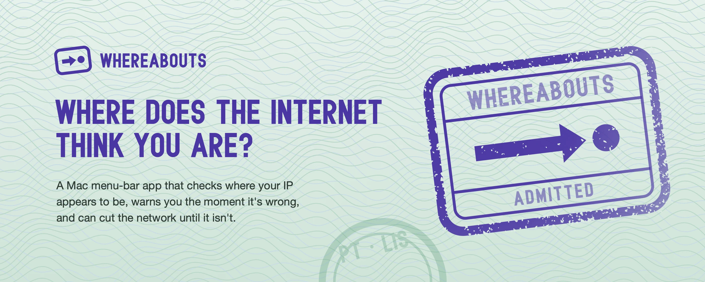
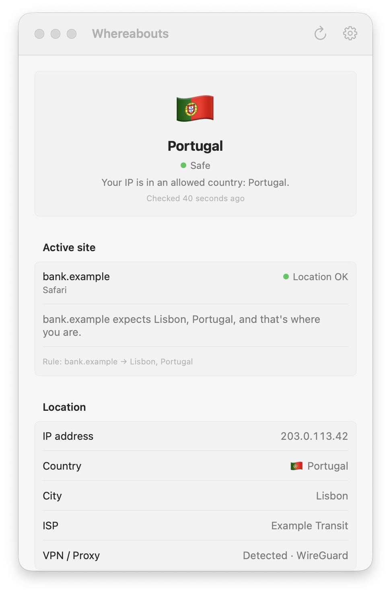
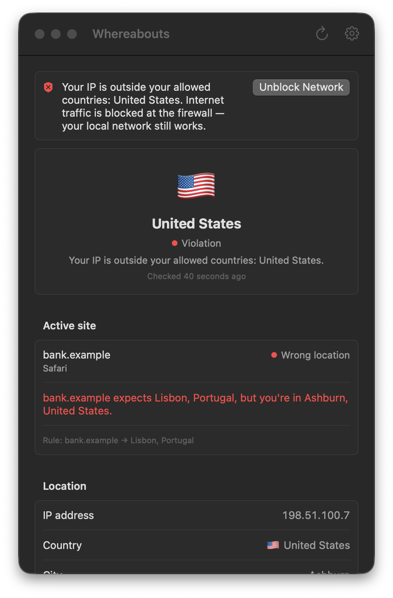
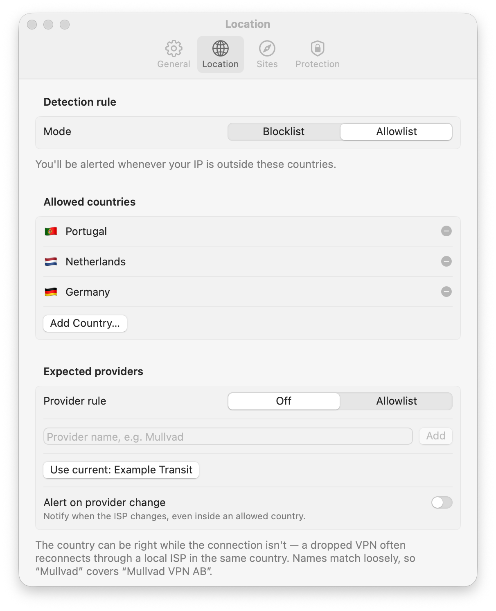

# Whereabouts



A macOS menu-bar app that keeps checking where the internet thinks your Mac is, and warns you or cuts the network when that place is wrong.

Whereabouts doesn't ask whether your VPN is connected. It asks where you appear to be and acts on that answer. On an interval it looks up the location of your public IP, checks it against your rules, and shows the answer in the menu bar as a place: a country code, a flag or a city.

> [!TIP]
> **Pairs with [Alibi](https://github.com/doxigo/alibi), its companion browser extension.** Whereabouts covers the Mac: where your IP appears to be, and whether the Mac's time zone, region, DNS and IPv6 tell the same story. Alibi covers the browser: a Chrome extension that sets the time zone, geolocation and locale sites see to match your VPN, for every site or one at a time. Run both and the Mac and the browser agree with your connection. See what sites see on Alibi's [check page](https://doxigo.github.io/alibi/).

## Screenshots

<picture>
  <source media="(prefers-color-scheme: dark)" srcset="Branding/screenshots/menubar-dark.png">
  
</picture>

| All clear | Kill switch engaged, dark mode | Country rules |
|---|---|---|
|  |  |  |

The screenshots use made-up data from the app's demo mode (`--demo`). `Branding/screenshots.sh` regenerates them.

## What it does

- **Country rules.** Allow or block countries.
- **Per-site rules.** Give a site its own location rule. Whereabouts watches the active browser tab through Apple Events and checks that site's rule against where you appear to be. Firefox-family browsers don't support this, so they get a best-effort read through Accessibility instead.
- **ISP checks.** Keep an allowlist of expected ISPs, and get an alert when the ISP changes.
- **Leak checks.** It also checks the quieter ways a location leaks: the IPv6 exit and the DNS resolvers. A leak sends a notification, but it never engages the kill switch.
- **Alerts.** Choose how a wrong location reaches you: a colored menu-bar item, a notification, a sound, a red line along the top of every screen. Turning the VPN off on purpose? **Pause for 1 Hour** in the menu holds the alerts and the kill switch.
- **Kill switch.** Cuts internet traffic on a country or ISP violation, or on a per-site rule that asks for it. If you unblock by hand, you get two minutes to reconnect your VPN: if the location still isn't allowed then, it blocks again. It re-arms sooner once every check is clear. With **Confirm before blocking** on, a second lookup provider cross-checks each violation. If the two disagree, the kill switch waits for the next check to agree.
- **Time zone, region and home clock.** Optionally moves the Mac to the VPN exit's time zone and region, so nothing on the Mac contradicts the IP, and back home when the VPN drops. With **Follow Alibi's location** on too, a place in Alibi for all sites (Tokyo, say) moves the Mac to that place's time zone and region instead; Off and Match my IP address in Alibi leave it to the connection. The menu-bar clock keeps showing your home time either way. No app can remove the macOS clock, so a setting shrinks it to its small analog face instead.
- **History.** Past lookups are kept, so you can see where this Mac has been seen.
- **Alibi follows along.** With [Alibi](https://github.com/doxigo/alibi) on **Match my IP address**, Whereabouts tells it the moment the exit changes, so the browser's time zone, language and location move with your VPN without waiting for Alibi's own once-a-minute check.
- **git-ip-guard follows along.** [git-ip-guard](https://github.com/doxigo/git-ip-guard) stops git from reaching your remotes while your IP is in a sanctioned country. While Whereabouts runs, git-ip-guard reads the location from Whereabouts' status file instead of looking it up again, so git and the menu bar agree on where you are. Settings › Protection shows whether it's installed, links to it if not, and has a switch to stop sharing.

### How Alibi hears about a new exit

Each time Whereabouts starts, it registers itself with Chrome and Brave as a native messaging host named `com.doxigo.whereabouts`. It writes `com.doxigo.whereabouts.json` into `~/Library/Application Support/Google/Chrome/NativeMessagingHosts` and `~/Library/Application Support/BraveSoftware/Brave-Browser/NativeMessagingHosts`, for whichever of the two is installed. The manifest points at the app's own binary and admits only Alibi's pinned extension ID, `dhlpjjenplighmpbogjpmljbahbnjpfa`. Moving the app is fine: the next launch rewrites the path.

When a check finds a new exit, the app writes its time zone, the country's most likely locale and its coordinates to `alibi.json` in `~/Library/Application Support/Whereabouts`. While Alibi has a cover on Match my IP address, or a place for all sites, Chrome keeps a copy of Whereabouts running in host mode (`Whereabouts chrome-extension://<id>/`). That copy sends Alibi the current exit, then each new one as soon as the file changes. It exits when Chrome hangs up or the app quits, and Alibi goes back to its own lookup.

The host also tells Alibi whether it takes Alibi's cover: while **Match my Mac's time zone and region** and **Follow Alibi's location** are both on, it first says `{"hello": "whereabouts", "accepts": ["cover"]}`, and otherwise the same with `"accepts": []`, so Alibi doesn't keep the port open for nothing. It says hello again when you switch them. Alibi then sends the configuration, time zone and locale of its **All sites** cover whenever they change, for example `{"cover": {"configuration": "tokyo", "timezone": "Asia/Tokyo", "locale": "ja-JP"}}`. Each host keeps the one it heard in a file of its own, `alibi-cover-<pid>.json`, and deletes it as it exits. The app skips, and deletes, any whose host is gone, so a closed browser or a removed Alibi never holds the Mac anywhere. With **Match my Mac's time zone and region** and **Follow Alibi's location** both on, a place moves the Mac to that place's zone and region. **Off** and **Match my IP address** ask nothing of the Mac, which follows the connection as it does without Alibi. With Alibi in more than one browser or profile, the newest place wins: Off or Match my IP address in one never outvotes a place in another, and closing a browser hands back to the others. A per-site cover stays in the browser, since the Mac has one clock. The host tells Alibi the zone the app holds the Mac on, `{"system": "Asia/Tokyo"}`, or `{"system": null}` while it holds none, for Alibi's popup to show; Alibi keeps covering the zone itself. Alibi Companion on Windows speaks the same protocol.

To set it up, open Whereabouts once, then load an Alibi version with the pinned ID (see Alibi's README) and choose **Match my IP address**. A Chrome Web Store copy of Alibi has a different ID, so it isn't admitted. For the Mac to follow a place you pick in Alibi, also turn on **Match my Mac's time zone and region** and **Follow Alibi's location** in Settings › Location. That needs an Alibi newer than 1.1.0. Older ones don't send their cover, so the Mac keeps following the connection.

### Reading the current location from other tools

After every location check, Whereabouts writes the result to `status.json` in `~/Library/Application Support/Whereabouts`, so local tools such as [git-ip-guard](https://github.com/doxigo/git-ip-guard) can use it instead of looking up the IP themselves. This is a stable interface: fields are only added, never renamed or removed.

```json
{"checkedAt":1761217200,"city":"Kista","country":"Sweden","countryCode":"SE","ip":"203.0.113.7","isVpn":true,"isp":"Example ISP","kind":"safe","pid":12345,"region":"Stockholm","version":1}
```

- `version` is `1`. `pid` is the running app's process ID. `checkedAt` is the time of the check, in whole Unix seconds.
- `kind` is Whereabouts' own verdict: `safe`, `violation`, `unknown`, `offline` or `checking`. Tools can apply their own rules to the location instead.
- `ip`, `countryCode`, `country`, `region`, `city`, `isp` and `isVpn` are left out when unknown, and always on `unknown`, `offline` and `checking`.

The file is replaced atomically. When the network changes or the Mac wakes, it says `checking` right away, so it never reports an old route's location while a new check is under way. It's deleted when the app quits, or when **Share location with Git IP Guard** (Settings › Protection, on by default) is turned off. After a crash it stays, so treat it as current only if `pid` is still running and `checkedAt` is recent.

### How the kill switch works

It loads block rules into the macOS packet filter (`pf`), in the anchor `com.apple/100.Whereabouts`. Network interfaces are never touched, so Wi-Fi keeps its lease and the local network keeps working. Nothing persistent is written, so a reboot always restores traffic.

`pf` needs root. Turning the kill switch on asks for your admin password once. It installs a root-owned helper in `/Library/Application Support/Whereabouts` and a sudoers rule at `/etc/sudoers.d/whereabouts-killswitch` that allows only that helper's own subcommands. Later blocks and unblocks run without a prompt. Turning the kill switch off lifts any active block and removes the helper and the sudoers rule.

### Where lookups go

Location lookups go to [ip-api.com](https://ip-api.com) on its free HTTP tier, the one provider that flags VPN and proxy exits, with [ipwho.is](https://ipwho.is) as a fallback. The IPv6 exit is read from `api6.ipify.org` or `ipv6.icanhazip.com`. With **Check for updates** on (Settings › General), it asks `api.github.com` once a day for the latest release; with **Install updates automatically** also on, it downloads that release's disk image from GitHub and restarts with it.

## Reading the menu-bar glyph

The menu-bar item is a small entry stamp next to the place. Calm states are an outlined stamp. Alarms are a solid stamp with the mark cut out, so a problem always looks heavier than an all-clear.

| Glyph | Meaning |
| --- | --- |
| Outlined stamp with an arrow arriving at a point | Location allowed |
| Solid stamp with `!` | Location not allowed |
| Solid stamp with a drop | Location leak detected |
| Solid stamp with `×` | Network blocked by the kill switch |
| Outlined stamp with `?` | Location unknown |
| Empty dashed outline | Offline |
| Empty faded outline | Checking location |

The kill switch state outranks every other state, and the all-clear glyph never shows while a leak or a violation is active. The glyph is monochrome and follows the menu bar's appearance. It turns color when the menu-bar color alert is on.

## Install

Download the latest `Whereabouts-<version>.dmg` from [Releases](https://github.com/doxigo/whereabouts/releases/latest), open it and drag **Whereabouts** to Applications. It needs an Apple silicon Mac on macOS 14 or later.

Releases are signed ad hoc, not notarized, so macOS blocks the first launch. Open the app once, then go to **System Settings › Privacy & Security** and click **Open Anyway**. Or clear the quarantine flag yourself:

```bash
xattr -dr com.apple.quarantine /Applications/Whereabouts.app
```

## Building

You only need Xcode's Command Line Tools. Full Xcode isn't required.

```bash
./build.sh
```

This builds a release binary for Apple silicon (arm64) and writes `build/Whereabouts.app`.

```bash
./build.sh install
```

This builds the app, quits any running copy, replaces `/Applications/Whereabouts.app` and launches it.

When only Command Line Tools are selected, the script builds against their macOS 26.5 SDK (`/Library/Developer/CommandLineTools/SDKs/MacOSX26.5.sdk`) if it's installed. The macOS 27 SDK turns `@State` into a macro whose plugin ships only with full Xcode, so a Command Line Tools build needs the 26.5 SDK. With Xcode selected, the script uses Xcode's own SDK.

### Code signing

macOS keeps permission grants (Automation, notifications) across rebuilds only when the app is signed with the same identity each time. Set `SIGN_ID` to the name of a code-signing identity in your keychain:

```bash
SIGN_ID="Your Identity Name" ./build.sh
```

If no matching identity is found, the script falls back to an ad-hoc signature. An ad-hoc signature changes on every build, so macOS may ask for those permissions again.

### Self-test

The app has a built-in self-test for its rule logic (XCTest isn't part of Command Line Tools):

```bash
build/Whereabouts.app/Contents/MacOS/Whereabouts --selftest
```

The [Build workflow](.github/workflows/build.yml) runs `./build.sh` and the self-test on a macOS 26 runner for every push to main and every pull request, so a break shows up before a release.

### Releasing

Pushing a version tag runs the [Release workflow](.github/workflows/release.yml) on a macOS 26 runner. It stamps the version from the tag into `Info.plist`, builds, runs the self-test, and publishes a GitHub release with the app on a disk image and generated notes:

```bash
git tag v1.1.0 && git push origin v1.1.0
```

To rebuild an existing tag's release, run the workflow from the Actions tab with that tag. It replaces the disk image on the release.

## Regenerating the icon

The app icon, its small variant and the wordmarks are all drawn from one geometry in `Branding/brand.py`. The lettering is built from strokes, so no font ships with the mark. To regenerate them:

```bash
Branding/build.sh
```

The script rewrites the SVGs in `Branding/`, then renders `Resources/AppIcon.icns` with `iconutil`, along with `Branding/icon.png`, `Branding/wordmark.png` and the README banner. It needs `python3` and `swiftc`, both included with Command Line Tools. The banner is encoded with `cwebp` (`brew install webp`); without it the script leaves `Branding/banner.webp` as it is. See [DESIGN.md](DESIGN.md) for the brand system.

The screenshots come from the demo mode, which shows made-up data and never looks anything up, saves settings or touches the firewall, so it can run beside your real copy:

```bash
./build.sh && Branding/screenshots.sh
```

`screencapture` needs Screen Recording permission for your terminal.

## Coming from GeoMeister

Whereabouts is the successor to GeoMeister. It uses the same settings and history format. On first launch, if Whereabouts has no settings yet, it copies GeoMeister's `settings.json` and `history.json` into `~/Library/Application Support/Whereabouts`. GeoMeister's own files are left untouched. The import runs only once.

## License

Whereabouts is free software under the [GNU General Public License v3.0](LICENSE).
